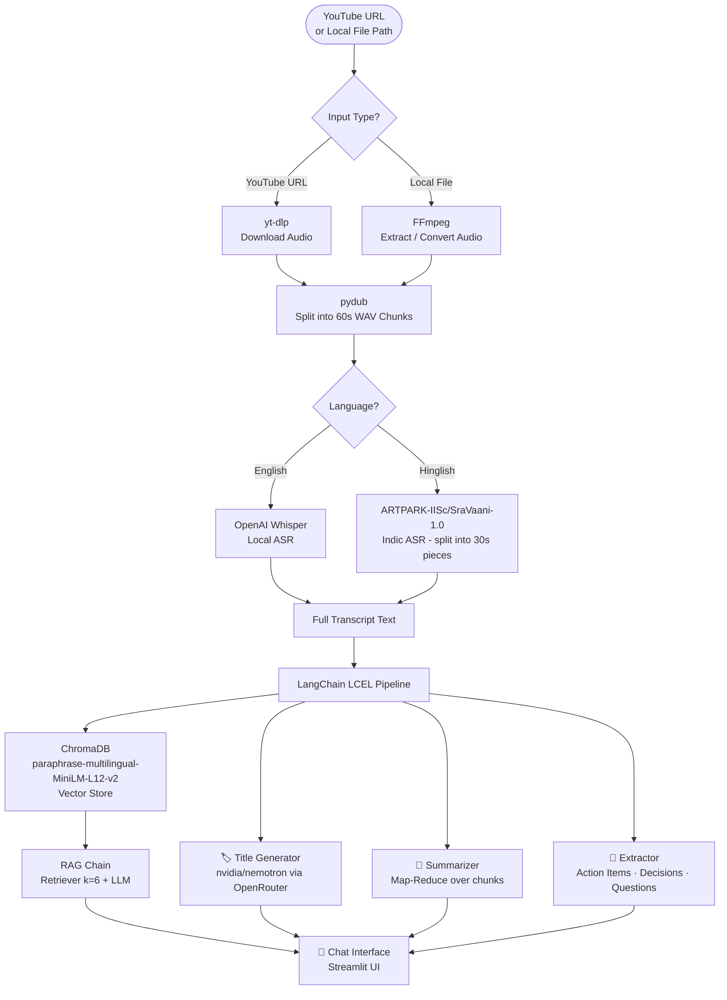

# 🎬 AI Video Assistant — Meeting Intelligence


> **Transform any YouTube video or local video/audio file into a fully searchable, AI-powered knowledge base.** Transcribe, summarize, extract action items, generate a smart title, and chat with the content — all in a beautiful dark-themed Streamlit UI.

---

## 📋 Table of Contents

1. [Overview](#-overview)
2. [Architecture](#-architecture)
3. [Tech Stack](#-tech-stack)
4. [Project Structure](#-project-structure)
5. [Prerequisites](#-prerequisites)
6. [Installation](#-installation)
7. [Configuration (.env)](#-configuration-env)
8. [Usage](#-usage)
9. [Features](#-features)
10. [Known Issues & Limitations](#-known-issues--limitations)
11. [🚀 Advanced Features Roadmap](#-advanced-features-roadmap)

---

## 🔍 Overview

**AI Video Assistant** is a full-stack local AI pipeline that lets you:

| Input | → | Output |
|-------|---|--------|
| YouTube URL | → | Transcript (English / Hinglish) |
| Local video / audio file path | → | AI-generated title & summary |
| — | → | Action items, decisions, key questions |
| — | → | Semantic RAG chat over the full transcript |

It runs **entirely locally** (no Whisper cloud calls, no Sarvam API). Only the LLM summarization/RAG uses an external API (OpenRouter — free tier available).

---

## 🏗 Architecture



---

## 🛠 Tech Stack

| Component | Library / Tool | Version | Purpose |
|-----------|---------------|---------|---------|
| **UI** | Streamlit | ≥ 1.40 | Dark-themed web interface |
| **Audio Download** | yt-dlp | ≥ 2025.1.1 | Download YouTube audio streams |
| **Audio Processing** | pydub | latest | Convert & chunk audio into WAV segments |
| **System Audio** | FFmpeg | 2026-build | Required for audio conversion & post-processing |
| **JS Runtime** | Node.js | ≥ 18 | Required for yt-dlp YouTube JS challenges |
| **ASR — English** | OpenAI Whisper | ≥ 20240930 | Local speech-to-text for English |
| **ASR — Hinglish** | ARTPARK-IISc/SraVaani-1.0 | HF | Indic ASR model for Hindi/Hinglish |
| **Deep Learning** | PyTorch | ≥ 2.5 | Backend for Whisper & SraVaani |
| **Model Loading** | Transformers (HF) | ≥ 4.40 | Load SraVaani via `AutoModel` |
| **LLM** | OpenRouter → `nvidia/nemotron-3.5-super-vl:free` | — | Summarization, extraction, RAG answers |
| **LLM Framework** | LangChain LCEL | ≥ 0.3 | Chains, prompts, output parsers |  
| **Embeddings** | `paraphrase-multilingual-MiniLM-L12-v2` | sentence-transformers ≥ 3.0 | Multilingual semantic embeddings (50+ langs) |
| **Vector DB** | ChromaDB | ≥ 0.5.5 | Local persistent vector store |
| **PDF Export** | fpdf2 | ≥ 2.8 | Export transcripts & summaries to PDF |
| **Config** | python-dotenv | ≥ 1.0 | Load API keys from `.env` |

---

## 📁 Project Structure

```
Video-AI-Assistant/
│
├── app.py                      # 🖥  Streamlit UI (dark cyber theme, pipeline status sidebar)
├── main.py                     # ⌨️  CLI entrypoint (non-interactive pipeline runner)
├── test.py                     # 🧪  Quick test script for audio → transcript pipeline
├── requirements.txt            # 📦  Python dependencies
├── .env                        # 🔑  API keys & configuration (not committed to git)
├── .streamlit/
│   └── config.toml             # ⚙️  Streamlit server config (headless mode)
│
├── utils/
│   └── audio_processor.py     # 🎵  YouTube download (yt-dlp) + pydub WAV chunker
│
├── core/
│   ├── transcriber.py         # 🗣  Whisper (English) / SraVaani (Hinglish) ASR router
│   ├── summarizer.py          # 📝  Map-reduce summarization via OpenRouter LLM
│   ├── extractor.py           # 📌  Extract action items, decisions, key questions
│   ├── vector_store.py        # 🔍  ChromaDB + multilingual embeddings build/load
│   └── rag_engine.py          # 💬  LCEL RAG chain + ask_question() helper
│
├── downloades/                 # 💾  Downloaded WAV chunks (auto-created, gitignored)
├── vector_db/                  # 🗄  ChromaDB persistent storage (auto-created, gitignored)
└── README.md
```

---

## ✅ Prerequisites

Before installing, make sure you have:

### 1. Python 3.12
```powershell
python --version   # Should show 3.12.x
```

### 2. FFmpeg (System-level — not pip)
Download from [ffmpeg.org](https://ffmpeg.org/download.html) or [gyan.dev builds](https://www.gyan.dev/ffmpeg/builds/).

Extract to `C:\ffmpeg\` so the binary is at:
```
C:\ffmpeg\ffmpeg-2026\bin\ffmpeg.exe
C:\ffmpeg\ffmpeg-2026\bin\ffprobe.exe
```
Add `C:\ffmpeg\ffmpeg-2026\bin` to your **Windows User PATH**.

> The app automatically injects this path into the process PATH at runtime as a fallback.

### 3. Node.js (≥ v18)
Required so `yt-dlp` can solve YouTube JS challenges.
Download from [nodejs.org](https://nodejs.org). Verify:
```powershell
node --version   # e.g., v24.19.0
```

### 4. API Keys
| Key | Where to Get | Required For |
|-----|-------------|-------------|
| `OPENROUTER_API_KEY` | [openrouter.ai/keys](https://openrouter.ai/keys) | LLM summarization, extraction, RAG (free tier available) |
| `HF_TOKEN` | [huggingface.co/settings/tokens](https://huggingface.co/settings/tokens) | Download SraVaani-1.0 (Hinglish only) |

For **SraVaani-1.0**, you must also accept the model terms at:
[https://huggingface.co/ARTPARK-IISc/SraVaani-1.0](https://huggingface.co/ARTPARK-IISc/SraVaani-1.0)

---

## 🚀 Installation

```powershell
# 1. Clone the repository
git clone https://github.com/your-username/Video-AI-Assistant.git
cd Video-AI-Assistant

# 2. Create and activate a virtual environment
python -m venv venv
.\venv\Scripts\Activate.ps1

# 3. Install Python dependencies
pip install -r requirements.txt

# 4. Create your .env file (see next section)
copy .env.example .env
# Then edit .env with your actual keys
```

> **Windows AVG Antivirus Note:** If you have AVG installed, it sets a broken `SSLKEYLOGFILE` pipe that crashes Python's SSL. The app automatically removes this environment variable at startup — no manual fix needed.

---

## 🔑 Configuration (.env)

Create a `.env` file in the project root with:

```dotenv
# ── REQUIRED ──────────────────────────────────────────────────────────
# OpenRouter API key (free tier: nvidia/nemotron-3.5-super-vl:free)
OPENROUTER_API_KEY=sk-or-v1-your_key_here

# ── REQUIRED FOR HINGLISH ─────────────────────────────────────────────
# HuggingFace token to download the gated SraVaani-1.0 model
HF_TOKEN=hf_your_token_here

# ── OPTIONAL — DEFAULTS SHOWN ─────────────────────────────────────────
# Whisper model size: tiny | base | small | medium | large
# Larger = more accurate but slower & needs more VRAM
WHISPER_MODEL=small

# SraVaani model ID (change only if using a different Indic ASR fork)
SRAVAANI_MODEL_ID=ARTPARK-IISc/SraVaani-1.0

# Audio chunk size in seconds for SraVaani pieces
SRAVAANI_PIECE_SECONDS=30
```

---

## 🎮 Usage

### Streamlit UI (Recommended)
```powershell
# Activate venv first
.\venv\Scripts\Activate.ps1

# Launch the app
streamlit run app.py
# Opens automatically at http://localhost:8501
```

**Workflow in the UI:**
1. Paste a **YouTube URL** (e.g. `https://youtu.be/VIDEO_ID`) or a **local file path** (e.g. `C:\Videos\lecture.mp4`)
2. Select **Language**: `english` or `hinglish`
3. Click **⚡ ANALYSE**
4. Watch the **Pipeline Status** sidebar as each step completes:
   - 🎵 Audio Processing → 📝 Transcription → 🏷 Title Generation → 📋 Summarisation → 📌 Extraction → 🔍 Vector Store
5. Review the **Title**, **Summary**, **Action Items**, **Decisions**, **Key Questions**
6. Use the **💬 Chat** panel to ask anything about the video content

### CLI Mode
```powershell
.\venv\Scripts\Activate.ps1
python main.py
# Follow prompts for URL/path and language
```

### Quick Test Script
```powershell
.\venv\Scripts\Activate.ps1
python test.py
```

---

## ✨ Features

| Feature | Description |
|---------|-------------|
| **YouTube Audio Download** | Streams & downloads audio from any YouTube URL via yt-dlp (no video download — faster) |
| **Local File Support** | Accepts any local `.mp4`, `.mkv`, `.avi`, `.wav`, `.mp3` path — FFmpeg extracts the audio |
| **Bilingual ASR** | English → OpenAI Whisper (local); Hinglish/Hindi → SraVaani-1.0 Indic ASR (local) |
| **AI Title Generation** | Auto-generates a concise, descriptive title from the content |
| **Map-Reduce Summarization** | Splits long transcripts into chunks, summarizes each, then merges for final summary |
| **Insight Extraction** | Automatically identifies action items, key decisions, and open questions |
| **Semantic RAG Chat** | Ask any question in English or Hindi — retrieves top-6 relevant chunks and answers via LLM |
| **Multilingual Embeddings** | `paraphrase-multilingual-MiniLM-L12-v2` supports Hindi ↔ English cross-language retrieval |
| **PDF/TXT Export** | Export transcript and summaries via fpdf2 |
| **Dark Cyber UI** | Custom Streamlit dark theme with pipeline status indicators |
| **UTF-8 Output** | Handles Hindi Devanagari characters correctly on Windows |
| **AVG Antivirus Compat.** | Auto-removes broken SSLKEYLOGFILE env var set by AVG |

---

## ⚠️ Known Issues & Limitations

| Issue | Details | Workaround |
|-------|---------|-----------|
| **SraVaani model is gated** | Requires HuggingFace account approval + `HF_TOKEN` | Accept terms at HF, add token to `.env` |
| **yt-dlp JS warning** | "No supported JavaScript runtime" warning (non-fatal) | Node.js must be in system PATH |
| **FFmpeg not found** | yt-dlp post-processing fails without FFmpeg | Install FFmpeg, add to PATH |
| **RAG answers "not found"** | Old ChromaDB collection from previous video polluting results | Fixed: collection is deleted & rebuilt on each new analysis |
| **Windows cp1252 encoding** | Hindi characters crash on `print()` | Fixed: `sys.stdout.reconfigure(encoding='utf-8')` applied |
| **AVG SSL crash** | `SSLKEYLOGFILE` pipe causes PermissionError | Fixed: env var removed at startup |
| **Large models on CPU** | Whisper `large` / SraVaani very slow on CPU | Use GPU or stick with `small` model |
| **YouTube format availability** | Some videos only have adaptive streams (no combined mp4) | Use `--merge-output-format mp4` flag (handled internally) |
| **SraVaani accuracy** | Model still improving; best for clearly spoken Hinglish | Works well for lectures, presentations |

---

## 🚀 Advanced Features Roadmap

Here is a prioritized roadmap of features that would transform this into a **production-grade, super-advanced** AI video platform:

---

### 🔴 High Impact — Build These First

#### 1. 🎙 Speaker Diarization (Who Said What)
Integrate **pyannote.audio** to label each speaker segment:
```python
from pyannote.audio import Pipeline
pipeline = Pipeline.from_pretrained("pyannote/speaker-diarization-3.1", use_auth_token=HF_TOKEN)
diarization = pipeline("audio.wav")
# → "SPEAKER_00: [0s–15s] | SPEAKER_01: [15s–45s]"
```
Combine with Whisper timestamps → attributed transcript: *"Alice: Can you explain the valuation model?"*

#### 2. ⏱ Timestamped Transcript with Clickable TOC
Use Whisper's word-level timestamps (`word_timestamps=True`) to generate:
- Clickable table of contents (jump to any topic)
- Highlight current segment during "playback"
- Timeline view of topic changes

#### 3. 💾 Persistent Vector DB Across Sessions
Currently the vector store is rebuilt on every run. Add session management:
```python
# Save/load by video ID hash
db_path = f"vector_db/{hashlib.md5(url.encode()).hexdigest()}"
# Skip rebuild if already exists
```
Saves minutes of embedding time for repeated queries.

#### 4. 🔄 RAG Reranking (Better Retrieval Accuracy)
Add **Cohere Reranker** or **FlashRank** to re-score retrieved chunks before LLM:
```python
from langchain.retrievers import ContextualCompressionRetriever
from langchain_cohere import CohereRerank
compressor = CohereRerank(model="rerank-multilingual-v3.0")
retriever = ContextualCompressionRetriever(base_compressor=compressor, base_retriever=base_retriever)
```
Dramatically reduces "I could not find this information" false negatives.

---

### 🟡 Medium Impact — Next Iteration

#### 5. 🎞 Keyframe / Slide Extraction
For lecture or presentation videos, extract keyframes at topic boundaries:
```python
import cv2
# Extract frame every N seconds, detect scene changes
# Display as visual thumbnail grid in the UI
```
Very useful for lecture recordings, webinars, conference talks.

#### 6. 😊 Emotion & Sentiment Analysis per Segment
Analyze emotional tone of each transcript segment:
```python
from transformers import pipeline
sentiment = pipeline("text-classification", model="cardiffnlp/twitter-xlm-roberta-base-sentiment")
# Per-segment: Positive / Negative / Neutral with confidence
```
Show a sentiment timeline chart in the UI.

#### 7. 📊 Real-time Transcription (Streaming)
Use **faster-whisper** (CTranslate2 backend — 4× faster):
```bash
pip install faster-whisper
```
Stream results token-by-token to the UI using Streamlit's `st.write_stream()`.

#### 8. 📄 Auto-Generated Meeting Minutes (Word Doc)
Use **python-docx** to generate a formatted `.docx`:
- Meeting title & date
- Attendees (from diarization)
- Summary, decisions, action items with owners & deadlines
- Full transcript appendix

```python
from docx import Document
doc = Document()
doc.add_heading('Meeting Minutes', 0)
# ... fill sections
doc.save('meeting_minutes.docx')
```

#### 9. 🔎 Searchable Transcript UI
Add full-text keyword search within the transcript:
```python
# Streamlit text_input for search term
# Highlight matching spans with st.markdown + HTML <mark> tags
# Jump to first match with anchor links
```

#### 10. 🌐 Multi-Language Output (Translation)
Let users choose their output language for summaries:
```python
from transformers import pipeline
translator = pipeline("translation", model="Helsinki-NLP/opus-mt-hi-en")
translated_summary = translator(hindi_summary)[0]['translation_text']
```
Support: Hindi → English, English → Hindi, French, Spanish, etc.

---

### 🟢 Power Features — Advanced Tier

#### 11. 📺 YouTube Playlist Batch Processing
Process an entire playlist in one click:
```python
import yt_dlp
with yt_dlp.YoutubeDL({'extract_flat': True}) as ydl:
    playlist = ydl.extract_info(playlist_url, download=False)
    video_urls = [entry['url'] for entry in playlist['entries']]
# Queue each video through the pipeline with progress tracking
```

#### 12. 🗣 Multi-Video Cross-Analysis
Build a **unified vector store** across multiple videos:
- Ask questions that span across a series of lectures
- Compare decisions made in different meetings
- Track recurring topics across a podcast series

```python
# Tag each chunk with its source video ID
# Use metadata filtering in ChromaDB retrieval
```

#### 13. 🏗 FastAPI Backend + REST API
Wrap the pipeline in a FastAPI app for programmatic access:
```python
from fastapi import FastAPI
app = FastAPI()

@app.post("/analyse")
async def analyse(url: str, language: str = "english"):
    # returns transcript, summary, extracted insights
    return pipeline_result

@app.post("/chat")
async def chat(question: str, session_id: str):
    # RAG chat with session context
    return {"answer": answer}
```

#### 14. 📅 Calendar Integration
Parse dates and deadlines from action items → create Google Calendar events:
```python
import dateparser
from google.oauth2.credentials import Credentials
from googleapiclient.discovery import build
# Extract: "Submit report by December 15th" → Calendar event
```

#### 15. 🔔 Webhook Notifications (Slack / Email / WhatsApp)
When analysis completes, send a notification with the summary:
```python
import requests
# Slack
requests.post(SLACK_WEBHOOK_URL, json={"text": f"✅ Analysis done!\n\n{summary}"})
# Email via SMTP or SendGrid
# WhatsApp via Twilio API
```

#### 16. 👥 Multi-User Authentication
Add user accounts with **streamlit-authenticator**:
```python
import streamlit_authenticator as stauth
authenticator = stauth.Authenticate(config['credentials'], ...)
name, auth_status, username = authenticator.login('Login', 'main')
```
Each user gets their own analysis history and vector stores.

#### 17. 🗂 Session History (SQLite)
Persist past analyses to avoid reprocessing:
```python
import sqlite3
# Schema: (id, url, language, title, summary, transcript, created_at)
# Load from history → skip audio download & transcription
# Browse past analyses in sidebar
```

#### 18. 💰 Cost & Token Tracking Dashboard
Track OpenRouter API usage and estimated costs:
```python
# Intercept LLM calls, count tokens (tiktoken)
# Display: tokens used today / this week, estimated cost, per-video breakdown
# Alert when approaching free tier limit
```

#### 19. 🐳 Docker Containerization
Package the app for one-command deployment:
```dockerfile
FROM python:3.12-slim
RUN apt-get install -y ffmpeg nodejs
COPY requirements.txt .
RUN pip install -r requirements.txt
COPY . .
CMD ["streamlit", "run", "app.py", "--server.port=8501"]
```
```bash
docker build -t video-ai-assistant .
docker run -p 8501:8501 --env-file .env video-ai-assistant
```

#### 20. ☁️ Cloud Deployment Options

| Platform | Cost | Notes |
|----------|------|-------|
| **Streamlit Community Cloud** | Free | No FFmpeg support — audio processing won't work |
| **HuggingFace Spaces** | Free (CPU) | Supports Docker spaces with FFmpeg |
| **Railway** | ~\$5/mo | Full Docker support, persistent volumes for ChromaDB |
| **Google Cloud Run** | Pay-per-use | Serverless, auto-scales to zero |
| **AWS EC2 / GCP VM** | \$10–30/mo | Full GPU support for fast Whisper |

> **Recommendation:** Railway with a Docker deployment is the easiest path to a live hosted version.

---

### 📊 Feature Priority Matrix

```
High Impact │ ████ Speaker Diarization      ████ Persistent Vector DB
            │ ████ Timestamped TOC           ████ RAG Reranking
            │
Med Impact  │ ████ Keyframe Extraction       ████ Meeting Minutes Export
            │ ████ Faster-Whisper Stream     ████ Searchable Transcript
            │
Low Effort  │──────────────────────────────────────────────────────────▶
            │  Easy                                               Hard
```

---

## 🤝 Contributing

1. Fork the repo
2. Create a feature branch: `git checkout -b feature/speaker-diarization`
3. Commit changes: `git commit -m "Add pyannote speaker diarization"`
4. Push and open a PR

---

## 📄 License

MIT License — see [LICENSE](LICENSE) for details.

---

## 🙏 Acknowledgements

- [OpenAI Whisper](https://github.com/openai/whisper) — Local English ASR
- [ARTPARK-IISc SraVaani-1.0](https://huggingface.co/ARTPARK-IISc/SraVaani-1.0) — Indic / Hinglish ASR
- [yt-dlp](https://github.com/yt-dlp/yt-dlp) — YouTube audio download
- [LangChain](https://www.langchain.com/) — LLM orchestration framework
- [ChromaDB](https://www.trychroma.com/) — Local vector database
- [OpenRouter](https://openrouter.ai/) — Unified LLM API (free tier)
- [Sentence Transformers](https://www.sbert.net/) — Multilingual embeddings

---

*Built with ❤️ for multilingual video intelligence.*
